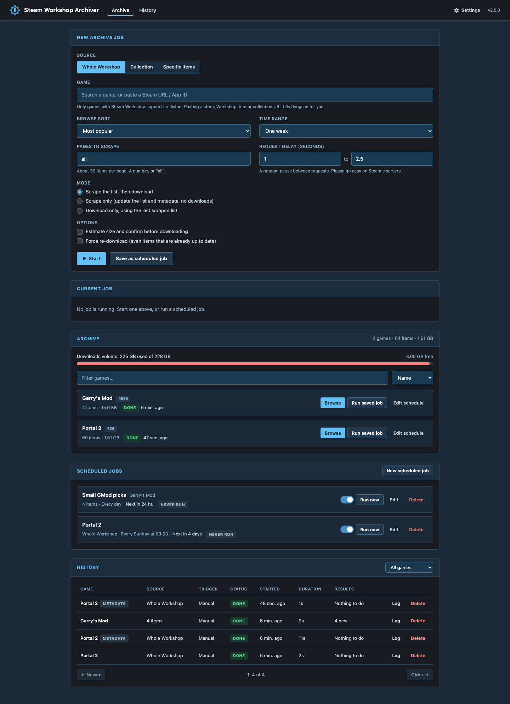
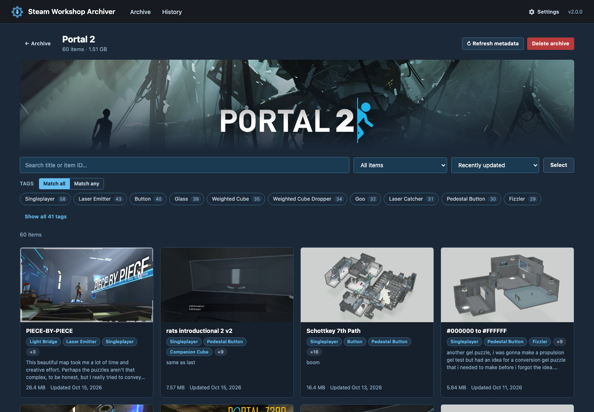
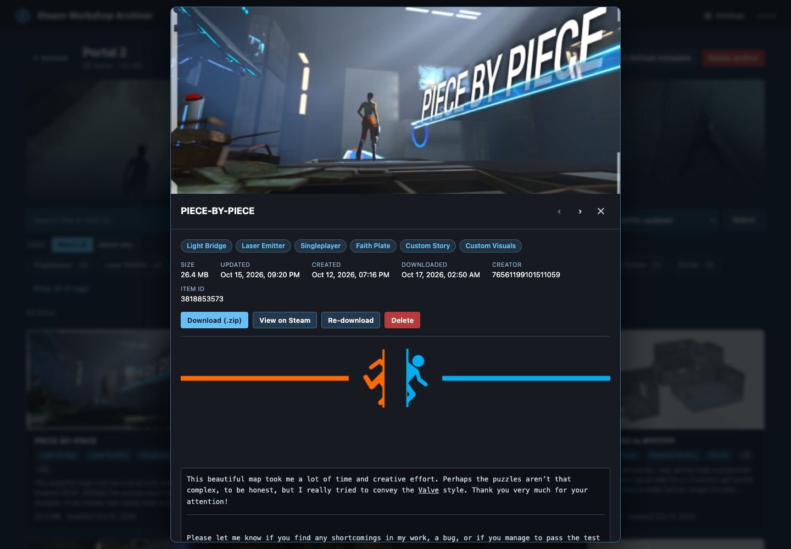
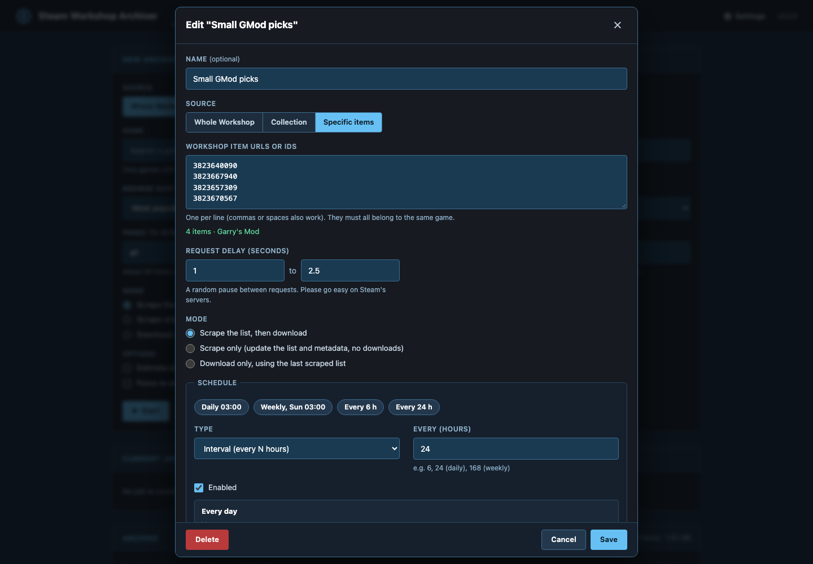
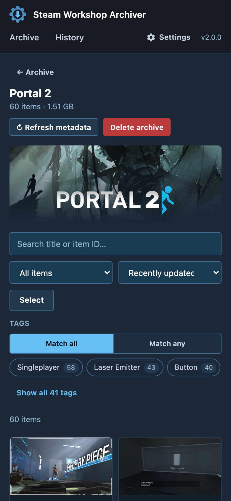

A self-hosted web app for archiving Steam Workshop content. List a game's Workshop (or a collection, or a handful of items), download it with SteamCMD or DepotDownloader, keep it up to date on a schedule, and browse everything offline — all from a browser.

  



| | |
|---|---|
|  |  |
|  |  |

> **Vibe coded.** AI-assisted, minimal ceremony. It's a wrapper around SteamCMD/DepotDownloader with an archive browser — meant to be useful, not over-engineered.

---

## Features

- **Three kinds of jobs** — a game's whole Workshop (with Steam's sort options), a **collection** (nested collections included), or a pasted list of item URLs/IDs. Paste a store, Workshop, item or collection URL straight into the search box.
- **Incremental updates** — every run checks Steam for each item's last-updated time and only downloads what's new or changed. Items removed from the Workshop are flagged and their local copies kept.
- **Official API or scraping** — with an optional free [Steam Web API key](https://steamcommunity.com/dev/apikey) items are listed through `IPublishedFileService/QueryFiles` (no 30,000-item browse limit, metadata in the same call); without one the browse pages are scraped.
- **Two download backends** — SteamCMD (batched, the default on x86) or [DepotDownloader](https://github.com/SteamRE/DepotDownloader) (also runs on arm64). Legacy single-file items are fetched straight from Steam's CDN.
- **Reliable downloads** — retries with backoff, stall detection, cancel that actually stops SteamCMD, and a clear hint when a game's Workshop needs an account that owns it.
- **Optional Steam login** — cache a login once (`swa-steam-login`) for games that don't allow anonymous downloads.
- **Queue & history** — jobs queue instead of colliding; every run is kept with counts, a full log, and **Retry failed**.
- **Schedules** — interval or cron (in your `TZ`) with a live preview of the next runs. Several schedules per game (e.g. one per collection).
- **Live progress** — progress bar, ETA, per-outcome counts and a streaming log that survives reloads and multiple tabs.
- **Notifications** — Discord, ntfy, Gotify, email, … via [Apprise](https://github.com/caronc/apprise/wiki) URLs, on every run or failures only.
- **Workshop browser** — fast paged grid with search, tag filters (any/all), sort, filters for outdated / removed / missing metadata, bulk select → download as one ZIP, re-download or delete. Filters live in the URL so views are linkable.
- **Offline-friendly metadata** — titles, descriptions (safe BBCode rendering), tags, preview and description images cached locally.
- **Disk usage** overview, mobile-friendly UI, keyboard accessible.

---

## Quick start

```yaml
# docker-compose.yml
services:
  steam-archiver:
    image: ghcr.io/pairofcrocs/steam-workshop-archiver:latest
    container_name: steam-archiver
    ports:
      - "8080:8080"
    volumes:
      - ./meta:/meta           # database, metadata, images, SteamCMD (fast disk)
      - ./downloads:/downloads # Workshop content (big disk)
    environment:
      - TZ=America/New_York
      - PUID=1000
      - PGID=1000
    restart: unless-stopped
```

```bash
docker compose up -d
```

Open **http://localhost:8080**. Images are published for `linux/amd64` and `linux/arm64` (SteamCMD only exists for x86, so arm64 uses DepotDownloader).

**Unraid:** a template is in [`unraid/steam-workshop-archiver.xml`](unraid/steam-workshop-archiver.xml) (PUID 99 / PGID 100, `/meta` on the cache pool, `/downloads` on the array).

To build locally instead: `docker build -t steam-workshop-archiver .`

---

## Usage

1. **Start a job.** Search for a game (or paste a URL / App ID), pick *Whole Workshop*, *Collection* or *Specific items*, choose sort and page count, and press **Start**. Tick *Estimate size and confirm* to review the download size first.
2. **Watch it run.** The job panel shows progress, counts and the live log. Other jobs wait in the queue.
3. **Browse.** Click **Browse** on a game to search, filter and open items, download them as ZIPs, or bulk-delete.
4. **Schedule.** *Save as scheduled job* turns the form into a recurring job (interval or cron). Scheduled runs only download new or updated items.
5. **History.** Every run is listed with its log; **Retry failed** re-queues just the items that failed.

### Games that need a Steam account

Many games allow anonymous Workshop downloads; some (often paid games) don't — runs then fail with *Access Denied* and the UI shows a hint. To use an account that owns the game:

```bash
docker exec -it steam-archiver swa-steam-login <your-steam-username>
```

Enter your password and Steam Guard code when prompted. Credentials are cached under `/meta` (never stored by the app). Then set the **Steam username** in **Settings**. For the DepotDownloader backend, also pass any Workshop item of that game so it caches its own login: `swa-steam-login <user> <appid> <item_id>`.

### Steam Web API key (optional)

Without a key the app scrapes the Workshop browse pages, which Steam caps at 1,000 pages (~30,000 items). With a key (free from <https://steamcommunity.com/dev/apikey>) listing goes through the official API with no cap. Set it in **Settings** or via `STEAM_API_KEY`.

---

## Configuration

Environment variables (UI-editable settings can also be changed in **Settings**, which take precedence):

| Variable | Default | Description |
|---|---|---|
| `TZ` | `UTC` | Timezone for cron schedules |
| `PUID` / `PGID` | `1000` | User/group files are written as (Unraid: `99`/`100`; `0` runs as root) |
| `AUTH_PASSWORD` | _(unset)_ | Enables HTTP Basic auth on everything except `/healthz` (any username) |
| `ALLOWED_HOSTS` | `auto` | Host header allowlist (DNS-rebinding protection). `auto` accepts IP addresses, `localhost` and LAN names (`tower`, `*.local`, `*.lan`, `*.home.arpa`, …). Add real domains you use, e.g. `auto,archive.example.com` behind a reverse proxy; `*` disables the check |
| `STEAM_API_KEY` | _(unset)_ | Steam Web API key (Settings) |
| `DOWNLOAD_BACKEND` | auto | `steamcmd` or `depotdownloader` (Settings) |
| `STEAM_USERNAME` | _(unset)_ | Use cached credentials for this account instead of anonymous (Settings) |
| `HTTP_DIRECT` | `1` | Fetch legacy single-file items straight from Steam's CDN (Settings) |
| `MAX_RETRIES` | `3` | Retry rounds per failed item (Settings) |
| `STALL_TIMEOUT_MIN` | `20` | Kill a download that shows no output or disk growth for this long (Settings) |
| `CONFIRM_TIMEOUT_MIN` | `60` | A size confirmation not answered in time cancels the run (Settings) |
| `METADATA_TTL_HOURS` | `24` | Re-fetch item metadata older than this (Settings) |
| `NOTIFY_URLS` | _(unset)_ | Space-separated Apprise URLs (Settings) |
| `NOTIFY_ON` | `all` | `all`, `failures` or `never` (Settings) |
| `FIX_PERMISSIONS` | `auto` | `auto` chowns everything only when PUID/PGID change; `full` every start; `off` never |
| `META_DIR` / `DOWNLOADS_DIR` | `/meta` / `/downloads` | Data paths |
| `LOG_LEVEL` | `INFO` | Server log level |

### Data layout

```
/meta/
├── archiver.db                    # SQLite: settings, schedules, run history, item metadata
├── logs/run-<id>.log              # full log of every run
├── steamcmd/                      # SteamCMD (self-updates + cached logins persist here)
├── home/                          # $HOME for SteamCMD / DepotDownloader
└── games/<appid>/
    ├── data.csv                   # last complete Workshop listing
    ├── previews/<item>.jpg
    └── desc_images/<item>/…       # cached description images + map.json

/downloads/steamapps/workshop/
├── appworkshop_<appid>.acf        # SteamCMD's manifest
└── content/<appid>/<item>/        # one folder per item (or <item>.bin for legacy items)
```

---

## Upgrading from v1

- Saved jobs (`saved_jobs.json`) and metadata caches (`games/*/metadata.json`) are imported into `archiver.db` on first start and renamed to `*.imported`.
- Containers now run as `PUID`/`PGID` **1000** by default instead of root. Set `PUID=0` to keep the old behaviour. Ownership is fixed automatically the first time.
- The HTTP API changed (`/jobs/*` → `/api/runs`, …). See [docs/api.md](docs/api.md).

## Security notes

- The app is meant for your LAN. Set `AUTH_PASSWORD` if anyone else can reach it. Requests for unknown domain names are refused by default (DNS-rebinding protection) — if you put it behind a reverse proxy with a real domain, add that domain to `ALLOWED_HOSTS`.
- All state-changing API requests must send the header `X-SWA: 1` (CSRF protection). Scripts using the API need to add it.
- Workshop descriptions are untrusted: they're rendered with a DOM-based BBCode renderer under a strict Content-Security-Policy, and the server only fetches description images from public internet hosts.

## API

See [docs/api.md](docs/api.md).

## Development

```bash
python3 -m venv .venv && .venv/bin/pip install -r requirements-dev.txt
META_DIR=./meta DOWNLOADS_DIR=./downloads .venv/bin/uvicorn app.main:app --reload --port 8080
.venv/bin/ruff check . && .venv/bin/pytest
node --test 'tests/js/*.test.mjs'
```

## License

[Unlicense](LICENSE) — public domain.
